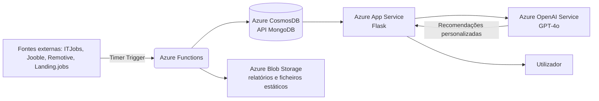

# Oportunia

<div align="center">
  
  <br><br>
  
  
  
  
</div>
<br>

**Assistente de Carreira para Estudantes de Informática Portugueses**

Plataforma cloud-native que agrega e personaliza oportunidades profissionais e académicas (estágios, empregos entry-level, bolsas de estudo e eventos tecnológicos) para estudantes de Engenharia Informática em Portugal.

## Sobre o projeto

Mais do que um agregador, o Oportunia funciona como uma camada de curadoria que cruza o percurso académico do estudante com as necessidades reais do mercado. A recolha de dados é automatizada (ITJobs, Jooble, Remotive e Landing.jobs) via Azure Functions, com os resultados persistidos em Azure CosmosDB e servidos através de uma interface web em Azure App Service. A análise semântica de perfis e a geração de recomendações personalizadas são feitas via Azure OpenAI Service.

Projeto desenvolvido no âmbito da unidade curricular de Computação em Nuvem (Licenciatura em Engenharia Informática, ESTCB/IPCB), em equipa.

## Arquitetura



A recolha corre de forma independente da aplicação principal, por Functions com Timer Trigger, o que permite atualizar os dados sem depender do tráfego da app. A app em si só lê do CosmosDB e chama o OpenAI Service quando precisa de gerar recomendações, mantendo os dois lados desacoplados.

## Stack técnica

- **Backend:** Flask (Python)
- **Base de dados:** Azure CosmosDB (API MongoDB)
- **Serverless:** Azure Functions (Timer Trigger), para recolha automática de dados
- **Armazenamento:** Azure Blob Storage, para relatórios e ficheiros estáticos
- **Deployment:** Docker + Azure App Service
- **Infraestrutura como código:** Bicep (ARM)
- **CI/CD:** GitHub Actions
- **IA:** Azure OpenAI Service (GPT-4o), para análise semântica de perfis e recomendações de compatibilidade

## Funcionalidades

- Registo e autenticação de utilizadores, com recuperação de password
- Dashboard com oportunidades agregadas de múltiplas fontes
- Relatórios semanais de oportunidades
- Perfil de utilizador com competências técnicas, usado para matching semântico via IA
- Recomendações personalizadas e justificadas, geradas pelo Azure OpenAI Service
- API REST própria (`/api/vagas`) que serve os dados persistidos no CosmosDB

## Decisões de engenharia

Optámos por CosmosDB com API MongoDB em vez de uma base relacional porque os dados agregados de fontes diferentes (ITJobs, Jooble, Remotive, Landing.jobs) não têm um esquema uniforme entre si, e um modelo de documentos evita andar a forçar esses dados a um formato comum antes de os guardar.

A recolha de dados ficou separada da aplicação principal em Azure Functions, correndo por Timer Trigger, para não bloquear a app enquanto está a fazer scraping ou chamadas a APIs externas, e para poder ajustar a frequência de recolha sem tocar no resto do código.

A infraestrutura foi definida em Bicep em vez de escrita manualmente no portal Azure, para que qualquer elemento da equipa consiga recriar o ambiente do zero e para reduzir erros de configuração entre ambientes.

## Como correr localmente

Antes de começar, é preciso ter uma subscrição Azure ativa com uma instância CosmosDB e acesso ao Azure OpenAI Service, já que a app depende desses serviços mesmo em desenvolvimento local.

1. Clonar o repositório
```bash
   git clone https://github.com/gajonormal/Oportunia.git
   cd Oportunia
```
2. Instalar dependências
```bash
   pip install -r requirements.txt
```
3. Configurar variáveis de ambiente (copiar `.env.example` para `.env` e preencher com as connection strings do CosmosDB, a chave do Azure OpenAI Service e o connection string do Blob Storage)
4. Correr a aplicação
```bash
   python app.py
```

## Infraestrutura

Toda a infraestrutura Azure (App Service, CosmosDB, Storage) é provisionada via Bicep (`main.bicep`), garantindo automação e reprodutibilidade.

## Limitações e próximos passos

O projeto foi pensado e construído no tempo de um semestre, por isso há coisas conscientemente deixadas de fora:

- Não há testes automatizados; a validação foi feita manualmente ao longo do desenvolvimento
- A recolha de dados está limitada às quatro fontes mencionadas; mais fontes exigiriam adaptar cada scraper individualmente
- O matching semântico depende inteiramente do Azure OpenAI Service, sem fallback caso o serviço esteja indisponível

## Equipa

Bernardo Maia, Leonardo Martins, Gonçalo Nunes, sob orientação do Prof. Osvaldo Santos.
